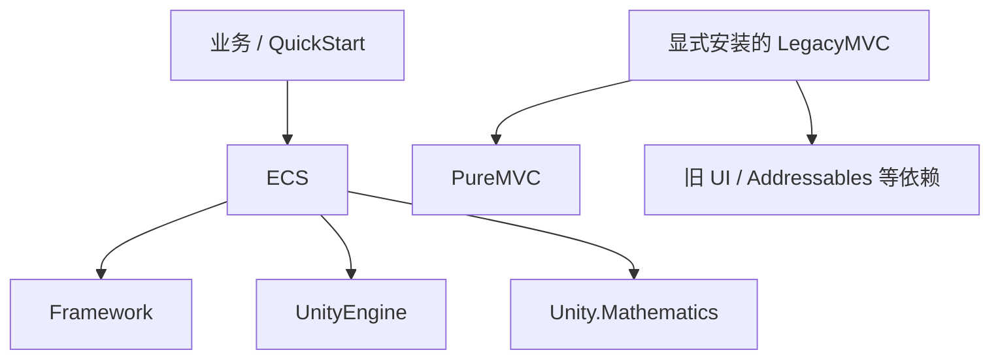

# 去 MVC：当前实现与后续设计

当前版本保持去 MVC 的边界，同时让 ECS 单向依赖 Framework。公共单例机制由 Framework 提供，ECS 保留自己的类型工厂、组件/系统池、资源所有权和更新/清理时序。详见 [Framework 接入](FRAMEWORK-INTEGRATION.zh-CN.md)。

## 当前依赖



基础包声明 Framework 和 Mathematics 的 UPM 依赖，UnityEngine 来自 Unity。Framework 单例负责公共 Unity 对象机制，ECS 负责自己的初始化、更新和清理顺序。旧 MVC/PureMVC 实际源码移动至 `Integrations~/LegacyMVC` 可选包，带 `~` 的目录不参与根包默认编译。基础 ECS 与该可选包没有程序集引用。保留旧源码不代表旧 MVC 生命周期会被 ECS 自动识别。

## ECS 自有基础设施

| 原依赖 | 本轮处理 |
| --- | --- |
| MVC.SingletonBehaviour | `ECS.SingletonBehaviour<T>` 继承 Framework.MonoSingleton；幂等初始化和更新时序留在 ECS |
| MVC.ReferencePool / ReflectionProvider | `ECS.ReferencePool`：CLR Type 分池、显式工厂注册、泛型直接构造，不扫描程序集 |
| MVC.IInitializeable / IRecycleable | ECS 同名可选接口；组件负责业务字段重置，系统由 World 正确安排初始化 |
| World/SystemBase 的 PureMVC.Notifier 基类 | 移除；需要通知的业务自行组合自己的通知服务 |
| MVC.AutoReleaseManager / GameObject.Recycle | 显式 `IGameObjectProvider` 和 `GameObjectLease`，由租约记录原始释放方法 |
| MVC.TimerManager 延迟回收 | ECS 管理器内的小型延迟释放队列，按 scaled delta 前进 |
| 包的 UI / Addressables / Burst 直接依赖 | 基础包移除；LegacyMVC 或使用相应功能的项目显式安装 |

生命周期接口保留熟悉的方法名：

```csharp
namespace ECS
{
    public interface IInitializeable { void OnInitialized(); }
    public interface IRecycleable { void OnRecycle(); }
}
```

组件从池取出后初始化；回收发生在系统缓存完成剔除后。系统通过未初始化的池入口创建，World 赋值后只初始化一次。池不自动重置所有用户字段，也不复制整个旧 MVC 框架。

## 无需程序集扫描如何创建

C# 泛型约束 `where T : class, new()` 已保证可以直接调用公开无参构造函数，编译时生成的工厂可以首次缓存：

```csharp
// 机制示意：首次遇到 T 时登记，后续先取同类型空闲对象。
Func<T> factory = () => new T();
```

因此公开启动入口只保留无参 `Ecs.Initialize()`，只初始化管理器，不枚举程序集类型。`AddComponentData<Position>()`、`RegisterSystem<MoveSystem>()` 和内部 Entity 创建会自动登记自身工厂。类型分布在多个 DLL/asmdef 不影响这条路径。

动态入口先明确登记：

```csharp
World world = Ecs.Initialize();
ReferencePool.Instance.Register<Position>();
ReferencePool.Instance.Register<Velocity>();
// 之后可通过 typeof(Position)、已注册类型名或 Archetype(Type[]) 创建。
```

`Register<T>(Func<T>)` 支持业务工厂，`Register(Type, Func<object>)` 支持动态表。自定义工厂须在首次取用前配置，不能覆盖同类型已经登记的不同工厂；重复默认 Register 幂等且保留已有自定义工厂。未注册类型明确失败，不按名称反射寻找构造函数，不恢复 LoadTypes。ComponentType ID 只用于匹配，不能代替工厂登记。

Unity 单例仍通过 `FindObjectsOfType<T>()` 查找已有场景组件；这是场景对象查找，与枚举程序集类型不同。移除程序集扫描减少启动时的类型枚举，不据此承诺每帧性能提升。

池的真实键是 CLR Type。唯一完整类型名可作为已注册类型别名；同名跨程序集类型用 Type 或程序集限定名，歧义名称拒绝。泛型直接构造提高 AOT 可达性；配置驱动的类型仍需显式可达注册，并在真实 IL2CPP 裁剪构建中验证。

## GameObject 与资源

保留 `Entity.gameObject`、HybridSystem 与 ComponentWrapper，避免把这次基础设施迁移扩成整个 Unity 层重写。

- `Create(go)` 默认由实体拥有，销毁时使用 Unity Destroy；`Create(go, GameObjectOwnership.Borrowed)` 只借用，实体销毁不销毁场景对象。
- `GameObjectLease.Owned(go, release)` 捕获实际来源的释放方法，`Borrowed(go)` 不释放对象；Dispose 幂等。
- `Create(lease)` 与 `BindGameObject(entity, lease)` 接受外部对象池或资源提供器租约，不能依赖全局 MVC 回收扩展。
- `EntityManager.Instance.GameObjectProvider` 默认未配置。已有对象绑定和数值逻辑可直接使用；调用 LoadGameObject 前由业务配置 provider。

Provider 接收请求并完成一个租约，回调必须回到 Unity 主线程。请求保存实体 GUID 和 request ID；旧生命周期、乱序或实体销毁后的结果由原租约释放，不绑定到复用实体。替换绑定先清除旧映射并刷新 Hybrid，再释放旧租约。一个原生对象不能同时作为多个实体/租约的所有物。

`DestroyEntity(entity, delay)` 在提交时退役实体和组件，delay 只延迟租约释放。队列按 scaled delta 前进，timeScale 为 0 时不累计延迟；退出清理仍需释放保留的租约。

## 使用与迁移

```csharp
using ECS;

World world = Ecs.Initialize();
var system = world.RegisterSystem<MoveSystem>();
var entity = EntityManager.Create();
EntityManager.Instance.AddComponentData<Position>(entity);
```

| 旧用法 | 本轮迁移 |
| --- | --- |
| 业务 asmdef 引用 ECS/MVC/PureMVC | 普通 ECS 业务引用 ECS、Game.Framework.Core、Game.Framework.Unity；直接使用 Math 时加 Unity.Mathematics |
| `using MVC` 为组件生命周期提供接口 | 改为 `using ECS`；同时使用旧库时显式限定 ECS 类型 |
| `MVC.IInitializeable` / `MVC.IRecycleable` | 改为 ECS 同名接口与原方法名 |
| `Ecs.Initialize<TMarker>()` / `Ecs.Initialize(assemblies)` | 两种旧入口均已移除；改用唯一的无参 `Ecs.Initialize()` |
| `LoadTypes` / 反射 Provider 注册 | 泛型自动登记；Type/string/Archetype 动态路径显式 Register |
| `SendNotification` 继承方法 | 业务显式持有通知服务；ECS 不提供隐式 PureMVC 兼容 |
| MVC 资源加载/回收 | 显式配置 provider，并用来源明确的 lease |

旧动态创建代码若依赖启动扫描或 LoadTypes 自动登记所有类型，必须在首次 Type/string/Archetype 创建前调用 Register；仅替换初始化方法名并不足以完成迁移。泛型创建仍会自动登记自身工厂。

默认 World 继续自动更新。多个 World 仍共享 EntityManager，DefaultWorld 以外的执行组由调用方显式调度；不存在本轮新增的 Runtime 隔离。旧 MVC 包只是旧框架的可选保留，不是自动生命周期桥。

## 验证与限制

[回归项目](CORRECTNESS.zh-CN.md)直接编译实际 ECS 自有池、单例及实体/系统实现；外部消费和 QuickStart 在独立程序集编译，并检查 ECS 的 AssemblyRef 没有 MVC/PureMVC。Unity 类型仍使用托管边界模型，实际安装图、渲染、原生 Destroy、域重载、场景与 Player 裁剪需要真实 Unity 工程继续验证。历史性能结果不能证明这次基础设施迁移后的新性能。

## 后续边界

继续按 Unity 框架维护，不推进 Core/Unity 产品拆分。连续组件存储和运行时隔离属于 ECS 自身的可选演进，不向 Framework 引入 Entity、World 或技能接口。Framework 接入不改变多个 World 共享全局实体表的现状。
